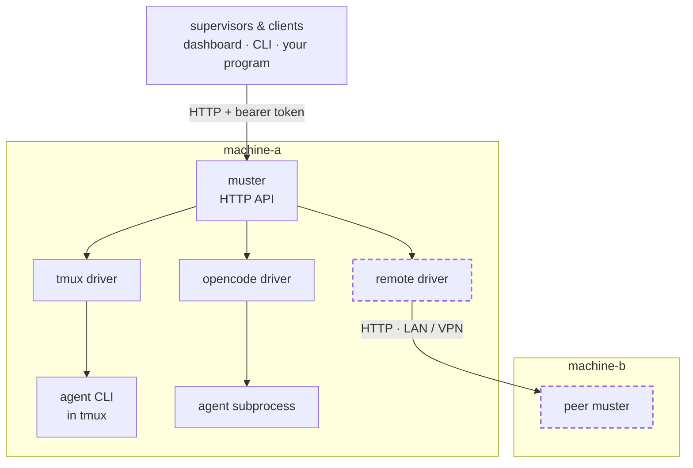

# muster

**One API for every coding-agent session you are running — on every machine you
are running them on.**

Go, standard library only, no dependencies. MIT.

You have coding agents running in terminals. Probably several. Possibly on more
than one machine. Right now the only way to know what any of them is doing is to
look at it, and the only way to answer one is to walk over to it.

`muster` is a machine-local service that **owns** those sessions and puts
them behind an HTTP API — list them, read what state each one is in, send one an
instruction, answer the permission dialog one is stuck on. Peer instances
federate, so a session on the machine in the other room is one call away and
looks exactly like a local one.



*A session driver is an interface. The remote peer is just another driver —
which is why federation cost nothing to add.*

---

## What problem this actually solves

A fleet of coding agents needs two separable things: something that decides
**what work should happen**, and something that knows **how a session is
actually run and where**. Most implementations fuse them — the supervisor shells
out to a terminal multiplexer, scrapes the screen to guess what the agent is
doing, and is thereby permanently bound to one runtime on one host. (Survey of
comparable projects, and what that split buys: [`docs/positioning.md`](docs/positioning.md).)

`muster` is the second half, extracted. Supervisors become clients.

Three properties fall out of that one decision:

- **Runtime independence.** A driver is an interface, not a hardcoded
  subprocess. Three exist today: a terminal multiplexer driving an interactive
  agent CLI, a third-party agent spawned as a subprocess and spoken to over
  HTTP, and a peer service on another machine.
- **Machine-to-machine is free.** A remote peer is *just another driver*. There
  was no separate federation feature to build.
- **Churn is contained.** When a runtime changes underneath you, the damage
  lands on one driver instead of everywhere.

That last one matters more than it looks. The value of the abstraction does not
depend on any particular runtime being good; it is what makes betting on one
affordable.

## What it will never own

Version control state, worktrees, issue trackers, work claims, planning, or any
judgement about whether work is finished.

> **muster knows a session has a working directory.
> It does not know what a worktree is.**

A fleet layer that learns what an issue is has become a second supervisor, and
now two components believe they are in charge. Every field in this API is tested
against that sentence.

What that means for a consumer — a dashboard that claims issues, spawns sessions
and merges branches, say — is that the dependency runs one way:

- **Work vocabulary is layered above, never pushed down.** A consumer that needs
  repositories, issues, claims, worktrees, locks or leases keeps them itself. The
  only places its vocabulary can appear here are opaque, caller-supplied fields —
  `marker` on session create, and a session's `labels`, set at create or changed
  later — which the service bounds in size, carries and returns without
  interpreting.
- **Consumers feature-detect and degrade.** What a machine can do is read, not
  assumed: `GET /v1/runtimes` says which runtimes are wired, and `build` on
  `GET /v1/machines` says which version answers. A consumer that finds a
  capability missing does less, rather than failing.
- **This service never calls a consumer back.** It opens connections only to its
  own runtimes and its peers. A consumer that wants to hear about change
  subscribes to `GET /v1/events`; nothing here holds a consumer's address.

---

## The parts that are unusual

Most tools in this space manage sessions on one laptop, for one vendor's agent,
behind a TUI. These are the properties that turned out to be rare — all of them
consequences of taking failure seriously. Each is worked through, with its state
and delivery diagrams, in [`docs/unusual-parts.md`](docs/unusual-parts.md); the
survey behind "rare" is [`docs/positioning.md`](docs/positioning.md).

- **A session has a state, not a pulse.** Finished, out of quota, died on an
  error and holding unsent text all look like a quiet terminal; here they are
  different states, each saying whether it was `observed` or `inferred`.
- **Sending a prompt is not fire-and-forget.** `submitted`, `queued`, `unknown`
  and `refused` are distinct outcomes; `unknown` means the text is stranded, not
  sent, and a retry never resubmits a human's text.
- **A session blocked on a dialog can be answered remotely** — by option index,
  carrying a nonce so the answer cannot land on a question that changed.
- **Every route is authenticated.** No unauthenticated mode, loopback bind by
  default, named principals with per-verb grants, every mutation audited.

---

## Install

Published to npm; one install surface. Needs Node 18 or newer to *launch* the
service — the service itself is a static Go binary and needs nothing else.

```sh
npx @futurelastic/muster serve        # run it once, nothing installed
npm i -g @futurelastic/muster         # or install the `muster` command
muster --version                      # muster <version> (...)
```

`@futurelastic/muster` is a small launcher: npm installs exactly one platform
package beside it and runs that binary. Nothing is downloaded at install time,
and every release carries npm provenance. Release candidates publish under the
`next` dist-tag; `latest` only moves to a final release. Windows is built and
tested by every release but not published to npm yet and has no
interactive-terminal driver — see [`docs/install.md`](docs/install.md#windows).

Configure it with the `FLEET_*` environment the [Quickstart](#quickstart) shows
and start it with `muster serve`. A service that survives a reboot is
[`docs/install.md`](docs/install.md). Build from source only to hack on it.

## Quickstart

Building from source: Go 1.26 or newer. No dependencies.

```sh
go build ./... && go test ./...
```

### One machine

```sh
export FLEET_MACHINE=machine-a
export FLEET_TOKEN="$(openssl rand -hex 32)"
export FLEET_ADDR=127.0.0.1:9000
go run ./cmd/muster serve
```

```sh
curl -s -H "Authorization: Bearer $FLEET_TOKEN" http://127.0.0.1:9000/v1/health
```

There is no default port — pick one and keep it. The default bind is loopback on
an ephemeral port, so a service you have not deliberately configured is
reachable only from its own machine.

### Two machines

Federating two instances is four steps — a credential per machine, the owner's
bind address, the caller's peer list, and one `GET /v1/machines` to verify. The
full walk-through is [`docs/multi-machine.md`](docs/multi-machine.md); what a
caller can then do (one fleet-wide session list, input and dialog answers sent
across the hop) is [`docs/driving-a-machine.md`](docs/driving-a-machine.md).

> **This is a demo, not an install.** Every process above ends with its shell.
> A service that survives a reboot — a principal table, a state directory, a
> service unit, and a `muster doctor` run that checks all of it — is
> [`docs/install.md`](docs/install.md); on one macOS or Linux machine,
> `muster service install` does it for the current user in one command.

## Who it serves

Clients, not end users. Three kinds are in mind, and the API treats them alike:

- **Session dashboards** — a view over every session on every machine, with the
  state each one is in and a way to answer the one that is stuck.
- **Coordinators** — programs that decide what work should happen and need a
  session to run it on; they hold the work vocabulary, this service holds the
  session.
- **Desktop and command-line apps** — a launcher or picker that lists sessions
  and attaches to one.

Which of these you are building decides where to start in
[`docs/client-guide.md`](docs/client-guide.md).

## Layout

| Path | What lives there |
|---|---|
| `cmd/muster/` | The `muster` binary: `serve`, `doctor`, `compat`, `principal` |
| `internal/` | The service: HTTP API, state store, session drivers, delivery, peer federation |
| `clients/` | Reference shell clients — [`clients/README.md`](clients/README.md) |
| `scripts/` | Gate, smoke, build and release scripts |
| `npm/` | The launcher and platform packages published to npm |
| `docs/` | API reference, specs, install and deploy procedures, ADRs — see [Documentation](#documentation) |

---

## Documentation

| If you want to | Read |
|---|---|
| Call the API | [`docs/api.md`](docs/api.md) — every endpoint at a glance |
| Write a client | [`docs/client-guide.md`](docs/client-guide.md) — a walkthrough, every example taken from a running service |
| Understand the design | [`docs/spec/session-abstraction.md`](docs/spec/session-abstraction.md) — the domain model. If you read one section, read §5.7 |
| Know the wire protocol exactly | [`docs/spec/api-http.md`](docs/spec/api-http.md) — normative |
| Adopt this in an existing system | [`docs/adoption.md`](docs/adoption.md) — staged so each step is reversible; §2 is the precondition that surprised us |
| Work on the service | [`docs/internals.md`](docs/internals.md) — measurements, decided questions, known gaps |
| Check a runtime build before the fleet takes it | [`docs/compat.md`](docs/compat.md) — `muster compat`: a versioned report of whether a candidate build still behaves as this service assumes |
| Set up two machines | [`docs/multi-machine.md`](docs/multi-machine.md) — credentials, bind address, peer list, verify; then [`docs/driving-a-machine.md`](docs/driving-a-machine.md) for what a caller can do across the hop |
| Install it on a new machine | [`docs/install.md`](docs/install.md) — from nothing to a running service, ending with `muster doctor` |
| Deploy it | [`docs/deploy.md`](docs/deploy.md) — from a merged commit to a service that already runs |
| Declare a machine-wide session identity | [`docs/session-identity.md`](docs/session-identity.md) — `sessionEnv`, precedence against a caller, verification |
| See what this is positioned against | [`docs/positioning.md`](docs/positioning.md) — a survey of comparable projects: category, what turned out rare, trajectory |

The specs carry the reasoning; the code is a transcription of them, not the
other way round. The session spec is organised so you can tell current truth
from history: **§1–§13 are normative**, **§14 lists what the document requires
but cannot enforce** — read it before trusting any guarantee — and **Appendix A
is the findings log**, the measurements and bugs that produced the rules.

That appendix is kept rather than smoothed away on purpose. A reader who knows
only a rule will restate it; a reader who knows how it was violated will
recognise the next instance.

---

## Where this is going

Done, in order, each one having changed the specification rather than merely
implemented it:

- ✅ **A first working driver** — a terminal multiplexer running an interactive
  agent CLI. It amended four sections of the spec and found one defect the spec
  cannot fix on its own.
- ✅ **Event subscription** — served as SSE with cursors, epoch, retention and
  announced resync. No polling anywhere.
- ✅ **A second driver: a remote peer** — federation, proven; neither service
  needed a special case.
- ✅ **Answering, not just observing** — enumerated options, a nonce, and
  verification that the prompt actually cleared.
- ✅ **A second *local* driver** — a third-party agent spawned as a subprocess,
  the first able to declare `observesState: true`.
- ✅ **State that survives a restart** — idempotency keys, event epoch and
  cursor, and driver session records persisted atomically.
- ✅ **A supervisor as a client** — a supervisor now talks to this service
  instead of to the terminal multiplexer. The plan that got there, including the
  precondition that could not be discharged from inside this repository, is
  [`docs/adoption.md`](docs/adoption.md).
- ✅ **A release path** — one npm install surface, release candidates and
  finals, and a Windows build that is tested on every release.

Next:

- ⬜ **Credential lifecycle.** Grants are per principal and per verb, and
  enrolment is a command. Nothing expires, a compromised token is revoked by
  editing a file, and changing a principal's grants means removing and
  re-adding it.
- ⬜ **Metrics.** Subprocess spawn cost is known to degrade with host load —
  8× on a machine under heavy load — and nothing measures it in production.
- ⬜ **Windows publication and an interactive-terminal driver there.** Built and
  tested today; not yet on npm, and the multiplexer driver is not available.

The honest list of what is missing is in
[`docs/internals.md`](docs/internals.md), kept current on purpose.

---

## License

[MIT](LICENSE). Copy it, run it, change it — the adoption path in
[`docs/adoption.md`](docs/adoption.md) exists for people who are not us, and a
documented adoption path with no licence grants them nothing.
