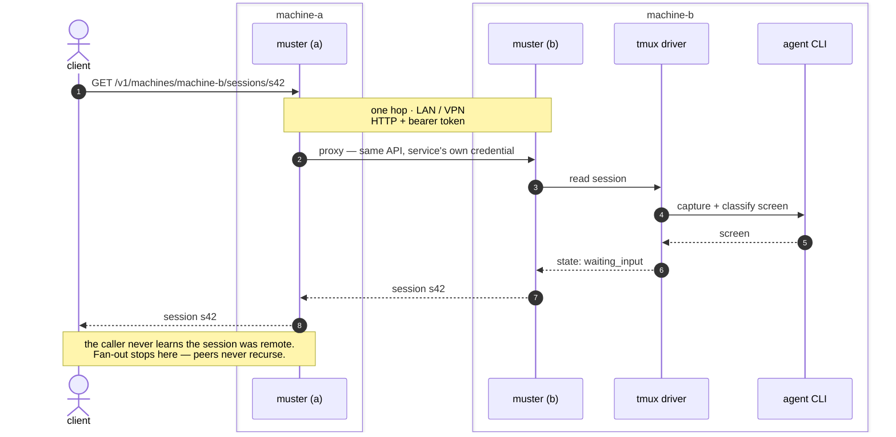

# Driving a session on another machine

What the [two-machine setup](multi-machine.md) actually buys you, end to end.
Every call is made against the **local** service; that it crosses a LAN or a VPN
to reach the other machine is the service's problem, not the caller's.



## Drive it

```sh
FLEET=http://127.0.0.1:9000
AUTH="Authorization: Bearer $(cat ~/.config/muster/machine-a.token)"
```

**Every session on both machines, as one list:**

```sh
curl -s -H "$AUTH" "$FLEET/v1/sessions?scope=fleet"
```

```json
{
  "items": [
    { "machine": "machine-a", "id": "s17", "state": { "status": "working",       "confidence": "inferred" } },
    { "machine": "machine-b", "id": "s42", "state": { "status": "waiting_input", "confidence": "inferred",
        "waitingOn": "prompt",
        "prompt": { "question": "Allow running tests?", "options": ["No", "Yes", "Yes, always"],
                    "selected": 1, "kind": "tool-permission", "nonce": "a3f1" } } }
  ],
  "sources": [ { "machine": "machine-a", "status": "ok" }, { "machine": "machine-b", "status": "ok" } ],
  "complete": true
}
```

Read `complete` before you trust that list. If the VPN was down, `machine-b`
would report unreachable, `complete` would be `false`, and the response would
still be a `200` — because "the machine did not answer" and "the session does
not exist" are different facts and must never look the same.

**Send an instruction to a session on the other machine:**

```sh
curl -s -X POST -H "$AUTH" -H 'Content-Type: application/json' \
  -d '{"text":"run the test suite","submit":true}' \
  "$FLEET/v1/machines/machine-b/sessions/s42/input"
```

```json
{ "outcome": "submitted" }
```

If that comes back `"unknown"`, the text is stranded in the composer on the
other machine and was not sent. Retry the identical call with
`"resumeIfStranded": true`.

**Answer the dialog it is blocked on** — quoting the nonce from the read above:

```sh
curl -s -X POST -H "$AUTH" -H 'Content-Type: application/json' \
  -d '{"choice":2,"nonce":"a3f1"}' \
  "$FLEET/v1/machines/machine-b/sessions/s42/respond"
```

`choice` is 1-based against `prompt.options`, so this answers **"Yes"**. If the
prompt changed while you were deciding, the nonce no longer matches and the
answer is refused rather than applied to a different question.

## What has to be true for that to work

| | machine-a (calls) | machine-b (owns the session) |
|---|---|---|
| Reachable address | — | `FLEET_ADDR` on the LAN/VPN interface |
| Peer configured | `FLEET_PEERS` | — |
| Write to own sessions | — | `FLEET_ALLOW_MUTATIONS=1` |
| Forward writes to a peer | `FLEET_ALLOW_RELAY=1` | — |

With a principal table those two booleans become per-identity grants: the caller
needs `relay` on machine-a, and the verb grant (`send`) is checked on machine-b.
They are separate refusals and you meet them one at a time. Both default to
denied, on a fresh deployment as much as an established one.

> **Exposing this is a decision, not a default.** The service reads paths and,
> when mutations are enabled, starts processes. Put it on a VPN or a trusted
> LAN segment, bind a specific interface, and give each caller its own
> credential with only the grants it needs.
