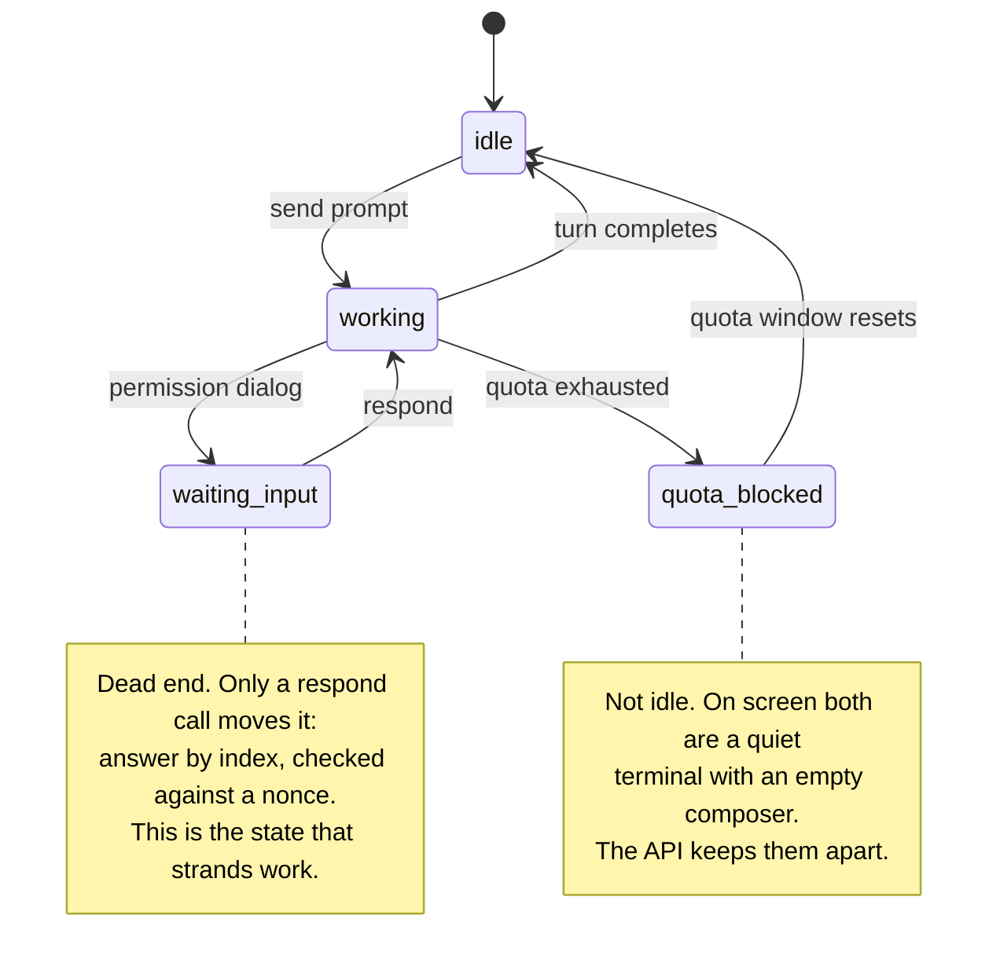
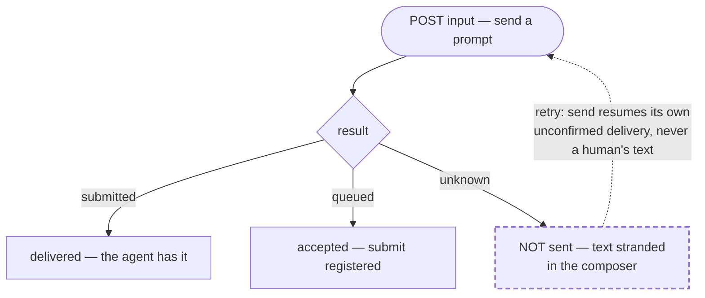

# The parts that are unusual

Most tools in this space manage sessions on one laptop, for one vendor's agent,
behind a TUI. The properties below are the ones that turned out to be rare, and
they are all consequences of taking failure seriously rather than features that
were designed for their own sake. ["Rare" is measured, not asserted —
`positioning.md`](positioning.md) is the survey behind this claim,
including the combination nothing else in it had.

### A session has a state, not a pulse

On screen, an agent that finished, an agent out of quota, an agent whose turn
died on a transient error, and an agent holding text nobody submitted all look
identical: a quiet terminal with an empty composer. Collapsing them is how
abandoned work goes unnoticed for a day.

So they are different states, each carrying its evidence, and every state says
whether it was `observed` from a structured read or `inferred` from a screen.

### Sending a prompt is not fire-and-forget

`unknown` means the text is sitting in the composer and was **not** submitted. A
system that reports success here loses instructions silently, and you find out
hours later when nothing happened. Retrying resubmits only text the service
itself placed there — never text a human typed.

There is a fourth outcome, `refused`, for when the driver actively protects the
session from input that would corrupt it. A refusal is information to act on,
not a fault to retry, so it arrives as an ordinary `200`.

### A session blocked on a dialog can be answered remotely

The dialog is read with every option enumerated, and you answer by index —
carrying a nonce, so your answer cannot land on a question that changed while
you were deciding. A session lost to a question nobody can reach is the most
expensive failure in a fleet, and an ordinary `send` cannot fix it: the property
that makes `send` safe for messages makes it useless for control.

### Every route is authenticated, and exposure is never accidental

There is no unauthenticated mode — not on loopback, not in development. A
service with no token refuses to start. The default bind is loopback on an
ephemeral port, and binding all interfaces logs a warning that names the risk.
Callers are named principals with per-verb grants; every mutation is audited
with an actor, not an address.
